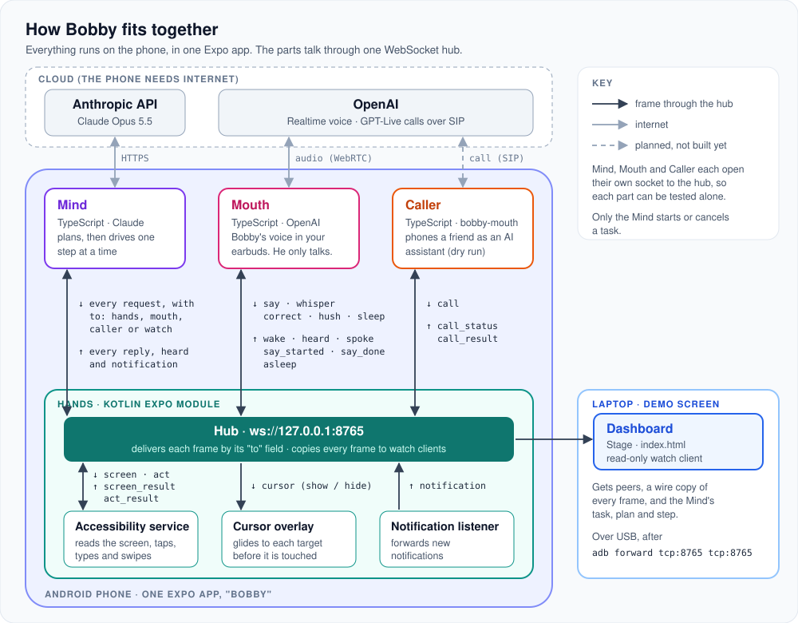
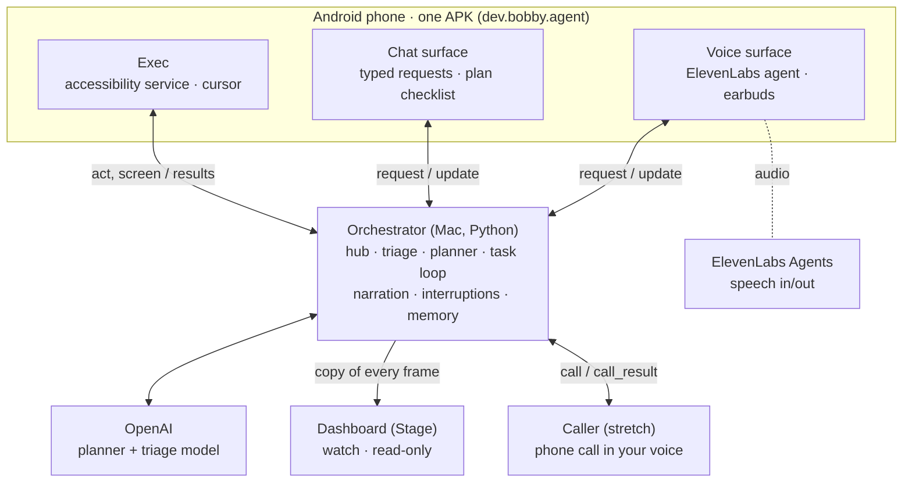

# Bobby: an AI coworker on your phone, by voice or text

Bobby is an Android agent that actually uses your phone for you. Ask out loud through your earbuds or type in a chat, "reply to Sarah and tell her 3 works", and Bobby does it the way you would: goes home, swipes to Gmail, opens Sarah's email, taps Reply, types and sends. A visible cursor leads every action, and Bobby says what it's doing and why as it goes ("I'm looking for 'Reply' to answer Sarah"). You can cut in at any point with "actually, make it 4" or "stop", by voice or by text, and it adjusts without starting over.

## How it works

**One system, two surfaces.** Voice and Chat are thin front ends. Both send the same `request` to one **Orchestrator** and both render the same `update` stream coming back. There is one planner, one task state machine and one execution engine (**Exec**), so a task started by voice can be changed or stopped from chat and the other way round.

1. **Request.** You say or type what you want. Voice's ElevenLabs agent calls a `start_task` tool; Chat sends every message as `auto` and the Orchestrator decides whether it's a question, a new task, a change, or a stop.
2. **Ack.** The Orchestrator answers within 300 ms, so Bobby says "On it" straight away.
3. **Plan.** The model writes a short plan (each step with a why). Chat and the dashboard show it as a checklist.
4. **Narrated act loop.** Read the screen (Android accessibility tree) → pick one action and one narration line → send the `act` to Exec and the `update` to the surfaces at the same instant → Exec glides the cursor, taps or types, waits for the screen to settle → repeat. Voice and cursor land together.
5. **Interruptions.** "Stop" cancels after the current action. "Actually make it 4" re-plans from the current screen, keeping progress. Talking over Bobby pauses the loop briefly.
6. **Done.** Exactly one `done`, `failed` or `cancelled` per task, spoken and shown in chat.

Every frame crosses one WebSocket hub, so the Stage dashboard can show the whole conversation, the plan ticking, each phone action and the voice/cursor sync live.

## Demo walkthrough

1. Press the Quick Settings tile. Bobby greets you and mentions what came in: "Sarah emailed, she's running late."
2. "Reply to Sarah and tell her 3 works." Bobby: "On it." The cursor goes home, swipes across home screens, finds Gmail, opens Sarah's email, taps Reply and types, narrating each step with its reason.
3. Mid-typing: "Actually, make it 4." Bobby: "Got it, 4 instead." The text changes, the task carries on, Bobby sums up the reply in one line and sends it. "Sent."
4. Open the chat screen: the whole voice exchange is in the thread, and the task card shows the finished plan.
5. Type "open Maps and search for coffee near me". The same agent does it, narrating in the chat. Press Stop half-way. "Cancelled."
6. Stay quiet for about 20 seconds: the voice session goes to sleep.
7. Stretch: "Call Alex and tell him I'm running late." Bobby places a phone call in your cloned voice and reports what Alex said.

## Team

| Who | Built |
|---|---|
| James H | Orchestrator: hub, triage, planner, task loop, narration, interruptions |
| Hamza | Exec + Android shell: accessibility service, cursor overlay, notifications, the one-APK scaffold |
| James C | Voice: ElevenLabs agent session, earbuds, barge-in, shortcuts |
| Wajeeh | Chat, Stage (dashboard, cursor art, app hints) and Caller |

## Tech

- **ElevenLabs Agents** for live voice (speech in and out, client tools, barge-in) and, for the Caller, outbound calls with a cloned voice.
- **OpenAI** models for triage, planning and per-step decisions in the Orchestrator.
- **Android accessibility service** to read the screen as text and perform taps, swipes and typing, with a cursor overlay; Kotlin + Jetpack Compose, one APK with feature modules.
- **Python hub** (`uv`) on the Mac: one WebSocket hub, contract v2, one socket per role.
