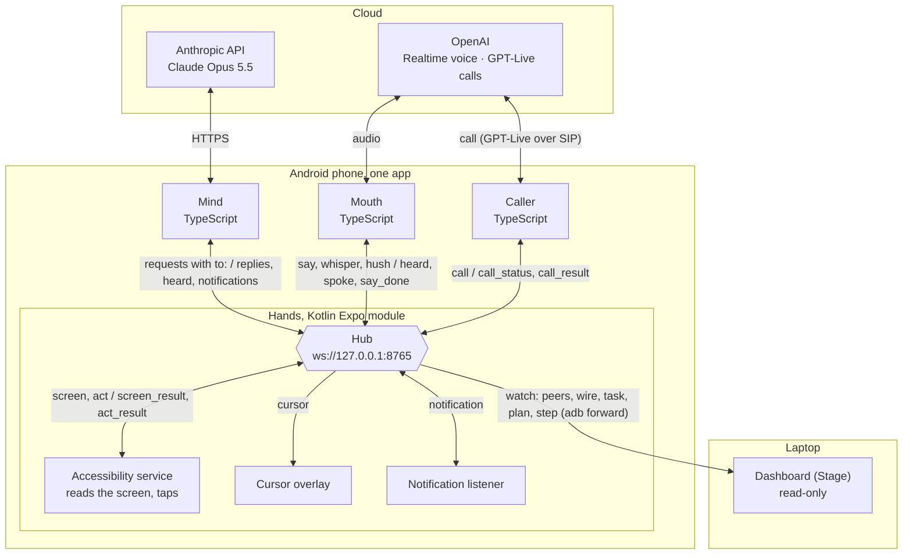

# Bobby

**A voice assistant that uses your Android phone for you, out loud, where you can watch.** Double-press the side button and talk to Bobby through your earbuds. Ask him to "reply to Sarah and tell her 3 works", and a cursor starts moving on the phone, doing it the way you would: home screen, swipe to Gmail, open Sarah's email, tap Reply, type, send. All the while Bobby tells you what he's doing and why ("I'm looking for the word 'Reply' to answer Sarah"). He tells you about your notifications when you wake him, and he can phone a friend for you, with an AI caller that says up front it's an AI assistant calling for you, and report back what they said. Say "stop" and he stops, at once.

> Draft for the project README. Status markers: **built** means it runs and is tested against the other parts' stand-ins; **planned** means it isn't built yet.

## How it works

Everything runs on the phone, in one Expo (React Native) app. There is no laptop server. The phone needs internet only because the models and the voice run in the cloud.

The app is four parts, built side by side by four people and merged at the end. They never call each other directly: each one opens its own WebSocket to a small hub on the phone and sends JSON messages through it. The messages are defined in one shared file, [`CONTRACT.md`](../../CONTRACT.md).

| Part | What it is | What it does |
|---|---|---|
| **Hands** (`hands/`) | Kotlin Expo module, the only native code | An Android accessibility service that reads what's on screen and taps, types and swipes. A cursor overlay that glides to each target before it's touched. A notification listener. And the **hub**, `ws://127.0.0.1:8765`, which delivers each message by its `to` field and copies every frame to watchers. |
| **Mind** (`mind/`) | TypeScript package, Claude Opus 5.5 | The slow brain. It reads what the user said, decides between chatting, starting a task, placing a call or cancelling, writes a plan, then drives the phone one step at a time: read the screen, pick one action, send Bobby the line to say and Hands the action at the same instant. It's the only part that starts or cancels a task. |
| **Mouth** (`mouth/`) | TypeScript package, OpenAI Realtime voice model | Bobby's voice in your earbuds. It turns speech into `heard` messages and speaks the lines the Mind sends, in order, in his own words. Bobby only talks: he never decides anything. |
| **Caller** (in `mouth/`) | TypeScript, OpenAI GPT-Live + a Twilio SIP trunk | Places a phone call to someone on an allowlist, in a stock voice that discloses it's an AI, with a goal from the Mind, and returns a summary and transcript. |
| **Stage** (`stage/`) | HTML and art | A live dashboard for the demo screen, the cursor artwork, the app icon, and per-app hints the Mind reads (how Gmail's buttons are labelled, how the home screen works). Nothing depends on it. |

The same diagram in Mermaid:

A few rules make it hang together:

- **Routing.** Every frame the Mind sends names its target in `to` (`hands`, `mouth`, `caller` or `watch`). Every frame from Hands, the Mouth or the Caller goes to the Mind. The hub doesn't read the messages, it only delivers them.
- **Voice and cursor together.** For each step the Mind sends the `say` to the Mouth and the `act` to Hands at the same moment. Bobby starts talking within a second and the cursor glide takes under a second, so the words and the movement land together. The Mind waits for both to finish before the next step, and works out the next step while Bobby is still talking.
- **The scenic route.** To open an app, the Mind presses home, reads the icons, swipes through the home screens and looks in folders, because watching it find things is the point. It jumps straight to an app only when the scenic route fails.
- **Separate sockets.** The Mind, the Mouth and the Caller each open their own connection, even inside one app. That's what let each part be built and tested alone, against stand-ins for the others.

## The demo, beat by beat

This is the story the dashboard's replay plays ([`stage/dashboard/story.jsonl`](../dashboard/story.jsonl)) and the one the Mind's `npm run story` runs end to end against its stand-ins.

1. **Wake.** You double-press the side button. The app opens, the Mouth starts Bobby's voice session and sends `wake`. Three notifications have come in (Hands forwarded them as they arrived): an email from Sarah, a WhatsApp from Alex, an Amazon delivery.
2. **The digest.** The Mind whispers all three to Bobby as background, then has him lead with what matters: "Hey! You've got three new things. Sarah emailed: she's running late and wants to push to 3."
3. **"Reply to Sarah and tell her 3 works."** The Mind starts a task and shows its plan on the dashboard: go home, find Gmail, open Sarah's email, write the reply, send it, each with a reason.
4. **The scenic route.** "Going to the home screen first, so I start from a known place." "Gmail isn't on this page, so I'm swiping to the next one." "There's Gmail. Tapping it to open your inbox." Each line is spoken as the cursor moves, and each plan step ticks off on the dashboard.
5. **The reply.** "I'm looking for the word 'Reply' to answer Sarah." The cursor finds it and taps. Bobby reads out what he's writing, "Hi Sarah, 3 works for me. See you then!", then taps Send. "Sent. I told Sarah 3 works."
6. **"Now call Alex and tell him I'm running 20 minutes late."** "Calling Alex now." The Mind sends `call` to the Caller with a goal and context. The dashboard shows dialing, answered, ended.
7. **The report.** The Caller returns a summary and transcript, and Bobby passes it on: "Alex says no problem: 3:20 works and he'll grab a table."
8. **"Stop."** At any point, "stop" or "cancel" cuts Bobby off mid-sentence, hides the cursor and cancels the task, in about a third of a second. The Mind catches short stop phrases before asking the model, so it doesn't wait on the network.
9. **Sleep.** After about 20 seconds with nothing said and nothing running, the Mind puts Bobby to sleep and the microphone goes off until the next double-press.

## Where each part stands

| Part | Built | Planned |
|---|---|---|
| Hands | The Expo module with the accessibility service, hub, cursor overlay, notification listener and keep-alive service. The test app runs on the Samsung S21; the hub's hello/welcome/peers and `screen` work on the phone. 94 unit tests. | Checking every action on the phone with screenshots, the scenic route to Gmail from a cold start, and the merged app in `app/`. |
| Mind | The decision loop, plans, step loop, scenic route, recovery, digest, calls, instant stop, corrections and sleep. `npm run story` passes 8 of 8 against stand-in phone, Mouth and Caller with the real model; 21 tests with the model stubbed. Runs inside Expo Go on an Android emulator, with a real model call. | A run against the real phone hub, and tuning on real screens. |
| Mouth | The hub client, the `say` queue, whisper, correct, hush, sleep and the asleep rules, and the test app, run in an emulator against a stand-in hub. | A live session with the OpenAI voice (it needs `OPENAI_API_KEY`) and earbud routing. |
| Caller | A dry run by default; the GPT-Live call over a SIP trunk, tested against stubs. | A real call: the Twilio SIP trunk and its credentials. |
| Stage | Dashboard with replay, hints for the home screen and seven apps, three cursors (`ring` chosen), app icon. | Fixing hints from the Hands part's on-phone check. |

## Run it

Each part's own README has the details.

- **Hands:** [`hands/README.md`](../../hands/README.md). Build the test app onto the phone with `npx expo run:android` in `hands/example`, then switch on the accessibility service.
- **Mind:** [`mind/README.md`](../../mind/README.md). `cd mind && npm install && ./check.sh`, then `npm run story` to run the whole demo against stand-ins (needs `ANTHROPIC_API_KEY` in the root `.env`).
- **Mouth and Caller:** [`mouth/README.md`](../../mouth/README.md). `cd mouth && npm install && ./check.sh`; the voice needs `OPENAI_API_KEY` in the root `.env`.
- **Stage:** [`stage/README.md`](../README.md). `node stage/dashboard/replay.mjs`, then open `stage/dashboard/index.html?hub=ws://localhost:8765&token=x`. On demo day, run `adb forward tcp:8765 tcp:8765` with the phone on USB and point the same page at the phone's hub.
- **The final app:** `app/README.md` once the Hands part has built it (planned). The order the team stitches the parts together is in the root [`README.md`](../../README.md).

## Keys and safety

- Keys are never baked into the build. A laptop script sends them to the app over USB, the app keeps them on the phone, and each package gets them through its `config`.
- The hub listens only on `127.0.0.1`, never on the network, and every connection needs a token.
- The Caller dials only numbers on its allowlist, and defaults to a dry run that dials nothing.
